<p align="center">
  
</p>

<h1 align="center">BODHI</h1>

<p align="center"><strong>Bridging, Open, Discerning, Humble, Inquiring</strong><br>
<em>The courage to ask before answering.</em></p>

<p align="center">An engineering framework for curiosity driven and humble AI in clinical decision support.<br>
This repository hosts the project website: <a href="https://criticaldata.github.io/bodhi">criticaldata.github.io/bodhi</a> (source: <a href="https://github.com/criticaldata/bodhi">github.com/criticaldata/bodhi</a>)</p>

## Quick Start

```bash
pip install bodhi-llm
```

## Links

| Resource | Link |
|----------|------|
| Website | [criticaldata.github.io/bodhi](https://criticaldata.github.io/bodhi) |
| Python package | [bodhi-llm on PyPI](https://pypi.org/project/bodhi-llm/) |
| Evaluation scripts | [humbleai-healthbench](https://github.com/sebasmos/humbleai-healthbench) |
| Curiosity driven QMoE | [curious-qmoe](https://github.com/sebasmos/curious-qmoe) |
| ModaLens code | [criticaldata/MODALENS](https://github.com/criticaldata/MODALENS) |
| Deterministic math solver code | [BODHI-Medcalc-NeurIPS](https://github.com/felipeocampoos/BODHI-Medcalc-NeurIPS) |

## Publications

- [ModaLens: Measuring Image Sensitivity in Report-Conditioned Medical VLMs](https://arxiv.org/abs/2609.15635) (arXiv, 2026) · [code](https://github.com/criticaldata/MODALENS)
- [Towards a Deterministic Math Solver for Clinical Language Models](https://arxiv.org/abs/2609.10728) (NeurIPS Global South CV Workshop, accepted; arXiv, 2026) · [code](https://github.com/felipeocampoos/BODHI-Medcalc-NeurIPS)
- [Beyond Overconfidence: Embedding Curiosity and Humility for Ethical Medical AI](https://doi.org/10.1371/journal.pdig.0001013) (PLOS Digital Health, 2026)
- [An Engineering Framework for Curiosity Driven and Humble AI in Clinical Decision Support](https://informatics.bmj.com/content/33/1/e101877) (BMJ Health & Care Informatics 33(1): e101877, 2026; [preprint](https://www.medrxiv.org/content/10.64898/2026.02.06.26345664v1)) · [code](https://github.com/sebasmos/humbleai-healthbench)
- [Humility and Curiosity in Human-AI Systems for Health Care](https://doi.org/10.1016/S0140-6736(25)01626-5) (The Lancet, 2025)
- [Uncertainty Makes It Stable: Curiosity Driven Quantized Mixture of Experts](https://arxiv.org/abs/2511.11743) (arXiv, 2025) · [code](https://github.com/sebasmos/curious-qmoe)
- [Teaching Machines to Doubt](https://www.nature.com/articles/s41591-025-04013-x) (Nature Medicine, 2025)

## Talks

- The BODHI Framework: Engineering and Testing Epistemic Virtues for Collaborative Intelligence in Clinical Decision Support. NeuroMonster 2026, AI Spotlights, June 2026 ([schedule](https://www.neuromonster.org/schedule)).

## Contact

- Sebastián Andrés Cajas Ordoñez ([sebasmos@mit.edu](mailto:sebasmos@mit.edu))
- Maximin Lange ([mlange2@mit.edu](mailto:mlange2@mit.edu))
- Leo Anthony Celi ([Google Scholar](https://scholar.google.com/citations?user=kssA7YwAAAAJ&hl=en))

---

<p align="center">© 2026 BODHI Research Group. Developed by MIT Critical Data and partner institutions worldwide.</p>
